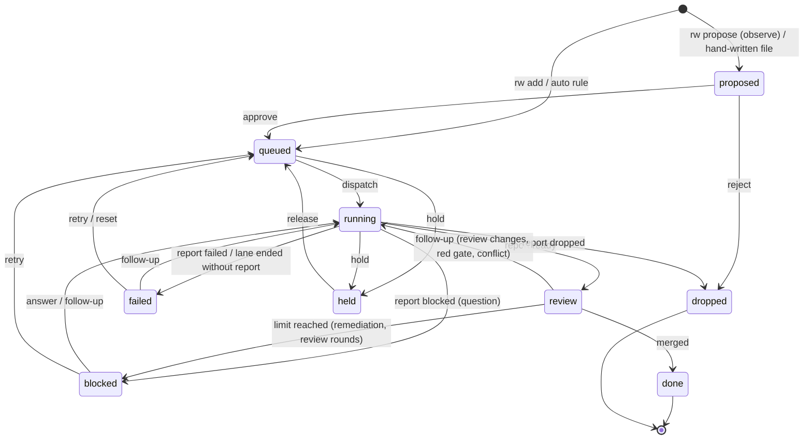

# 01 Model

The concepts, the states a task moves through, and who moves it. Code, prompts and the board use these
words and no others. Builds on [00 Principles](00-principles.md).

## Concepts

| Concept | What it is | Rules it keeps |
| --- | --- | --- |
| Task | One bounded change one worker can deliver and prove alone: `work/tasks/TASK-###.md` | Its **mandate** (basis, authority, scope, accept) is immutable once dispatched; different or wider work is a new task |
| Mandate | Why the work may be done (`basis`: `explicit` or `rule:<id>`), who said so (`authority`), how far it may go (`scope`), how it is proven (`accept`) | rw fingerprints it at dispatch; the watchdog fails on any later edit |
| Lane | One executor run of one task: a worktree, a branch, a resumable session | One writer per lane; its scope is owned until the task merges, drops or is stopped |
| Report | The worker's result: `work/reports/TASK-###.md`, committed on the lane branch | `ready` needs every acceptance command passing, a clean committed branch, and every change in scope |
| Question | One concrete question on a blocked task | Shown first on the board; `rw answer` sends the answer to the same session |
| Follow-up | Text delivered to a task's existing session: an answer, a review finding, a red gate, the owner's change request | Never a new task; never widens the mandate |
| Gate | Deterministic checks: intake (policy), report (contract + diff), merge (re-run commands on the merged branch) | Code decides; prompts cannot change it |
| Watchdog | An independent read-only audit | Speaks only on deviation |

An **executor** (Claude Code, an Antigravity bridge, a DSH Session, a person) runs a lane. A **tier**
(`light`, `build`, `review`) is an ordered list of executors with fallback. Neither is a domain concept:
they are configuration ([03](03-executors.md)).

## Roles

| Role | Who | May |
| --- | --- | --- |
| Owner | a person | authorize (`add`, `approve`, `reject`), answer, follow up, hold, release, stop, retry, decide a review |
| Router | `rw loop` (code), or an agent following the rw-router skill | dispatch, start reviews, merge, halt; never implement |
| Worker | an agent in a lane | change files inside its scope, `rw report`, `rw propose` |
| Reviewer | an agent in a read-only lane | read the diff, `rw verdict` |
| Watchdog | `rw watchdog`, ideally from a separate scheduled session | read |

rw refuses owner commands from inside a lane (its environment carries `RW_TASK`). That is a guard, not a
security boundary: a lane has a shell. [04 Hosts](04-hosts.md) lists where each host can and cannot
enforce it.

## Task states

`stop` drops a task from any live state. The full table is `TRANSITIONS` in `src/core/model.ts`; any
move it does not list is refused with the reason.

States that still **own their scope** (no other lane may write there): running, review, blocked, failed,
held. States that **wait for the owner** (the loop never moves them): proposed, blocked, failed, held.

## Rejected concepts

| Rejected | Why |
| --- | --- |
| Sources, Triggers, Threads, Channels (dsh-superagent) | Local work has one source: the owner. A request becomes a task or a follow-up directly |
| Eval with a model assessment per request | The owner's request is explicit; agent ideas go through a deterministic gate in `observe` by default |
| Subscriptions | A task's follow-ups go to its own lane session; nothing else needs routing |
| A web panel | `rw status` answers the same three questions; the DSH plugin exposes it as a tool |
| Waves as a concept | A wave was a dispatch round; `rw loop` dispatches whenever a task is ready, so batching is a property of the queue, not an artifact |
| Task state inside task files | Two writers (agents editing, rw recording) on one file; state goes stale in git |
| An "in progress" report | Liveness comes from the executor's output (heartbeat); progress is internal |
