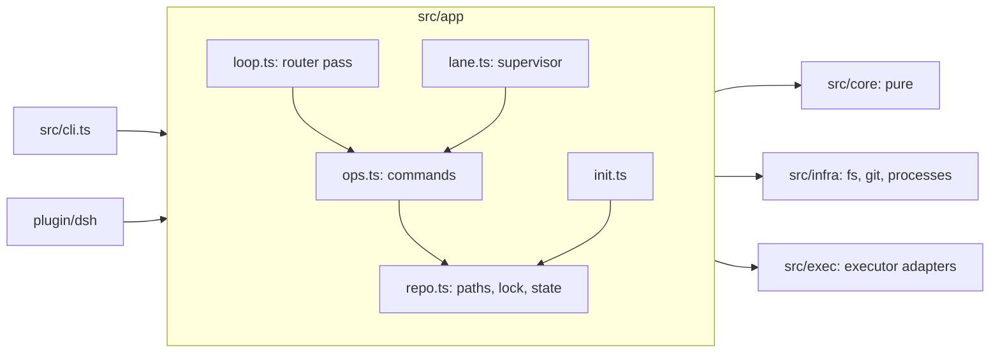

# 05 Architecture

The code map and the rules that keep it small. Builds on [04 Hosts](04-hosts.md).

## Layers

| Layer | Holds | May import |
| --- | --- | --- |
| `src/core/` | the model, parsers, the packet, the gate, the board, the watchdog's judgement. Pure: no file system, no clock, no processes (except `node:crypto` for hashes) | `core` only |
| `src/infra/` | atomic writes, the lock, git commands, process spawning | node built-ins |
| `src/exec/` | turning a prompt into an executor invocation, reading its log | `core`, the config types |
| `src/app/` | commands, the loop, the lane supervisor, init, config | everything above |
| `src/cli.ts`, `plugin/dsh/` | hosts: argument parsing, DSH glue | `app` |

Rules:

- **No runtime dependencies.** Node built-ins only. Dev dependencies are `typescript` and `@types/node`.
- **Erasable TypeScript only** (`erasableSyntaxOnly`): no enums, no parameter properties, no namespaces,
  so Node and Bun run the source without a build.
- **One writer of state.** Only `Repo.update` writes `state.json`, under the lock, through the pure
  functions in `core/state.ts`, which refuse any transition `TRANSITIONS` does not list.
- **Commands return data; hosts print.** `ops.ts` never writes to stdout.
- **Fail loudly.** A bad task file, config key, placeholder or transition throws with what to fix.
  `UserError` is a refused command (exit 2); anything else is a bug (exit 1).

## Modules

| Module | Does |
| --- | --- |
| `core/model.ts` | states, transitions, records |
| `core/frontmatter.ts` | the strict frontmatter dialect |
| `core/task.ts` | task contracts: parse, render, fingerprint, set validation (unknown deps, cycles) |
| `core/report.ts` | reports: parse, the Commands table, what each state must say |
| `core/scope.ts` | scope globs, out-of-scope files, conservative overlap |
| `core/plan.ts` | the dispatch packet: ready, waiting (why), attention, review, halt |
| `core/policy.ts` | the intake gate for proposals |
| `core/state.ts` | transitions, registration, lane patches |
| `core/status.ts` | the board |
| `core/watchdog.ts` | deviations from collected facts |
| `core/prompt.ts` | template filling; an unknown placeholder fails |
| `app/config.ts` | `.rw/config.json`: defaults, validation, tier chains, worktree root |
| `app/repo.ts` | repository paths from any worktree, contracts on disk, locked state, the board file, the `rw` shim |
| `app/ops.ts` | every command, including dispatch, report, merge, review, follow-up delivery and launchers |
| `app/lane.ts` | the detached lane supervisor and `settle` |
| `app/loop.ts` | one router pass |
| `app/init.ts` | the repository kit and host installs |
| `exec/executors.ts` | `claude` and `command` invocations, log parsing, capacity detection |
| `plugin/dsh/index.ts` | the DSH plugin: timer, tools, skills, Session lanes |
| `plugin/dsh/tools.ts` | the tool definitions over `ops` |

## Tests

`npm test` runs `node --test`:

| File | Covers |
| --- | --- |
| `tests/core.test.ts` | the pure core: parsing, scope, packet, gate, transitions, watchdog, config, prompts |
| `tests/e2e.test.ts` | a real git repository, `rw init`, detached supervisors and a scripted executor (`tests/fixtures/fake-worker.mjs`): add → merge, scope refusal, question → answer in the same session, capacity fallback, red gate returned to the lane, review rounds, a gate that writes files, hold ending the executor, symlink refusal (POSIX), worktree
prepare (success and failure), merging beside unrelated owner edits and waiting on a colliding one, a failed setup fixed on the base and retried, reset refusing and forcing, teardown of a worktree that lost its `.git`, `--executor` model choice, `verifyReport`, the merge gate log, leftovers and `rw clean` (never touching folders rw did not create), per-command help, missing report, owner-only guard, proposals, mandate drift |
| `tests/dsh-plugin.test.ts` | the plugin against a fake DSH context |

`npm run check` is typecheck + tests. Set `RW_KEEP=1` to keep the e2e repository for inspection.
CI (`.github/workflows/ci.yml`) runs both on Ubuntu and Windows, Node 22.18 and 24.

`scripts/smoke.mjs` is the live check the suite cannot be: one small task to a real executor in a
throwaway repository, built to make the worker ask a question, then answered, resumed, reported and
merged. `npm run smoke:claude` (`--model sonnet` for another model, `--keep` to inspect the repository);
`npm run smoke:fake` checks the script itself with the scripted worker.

## Extending

- **A new executor kind**: add its config shape in `app/config.ts`, its invocation and log reading in
  `exec/executors.ts`; if it runs in-process, register a launcher (`ops.registerLauncher`) like the DSH
  plugin does.
- **A new host**: install the same `skills/` into the host's location in `app/init.ts`; never fork the text.
- **A new check**: if it judges facts, add it to `core/watchdog.ts` with a test; if it is a repository
  command, it belongs in that repository's `watchdog.checks` or `gates.merge`, not in rw.
- **A new concept**: first try an attribute of an existing one or a line of prompt text
  ([00](00-principles.md)).
